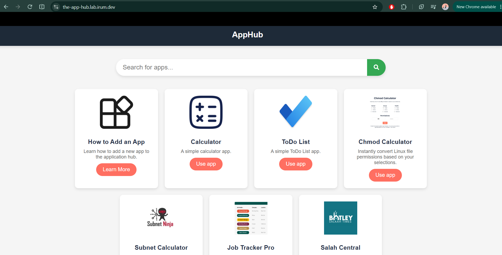
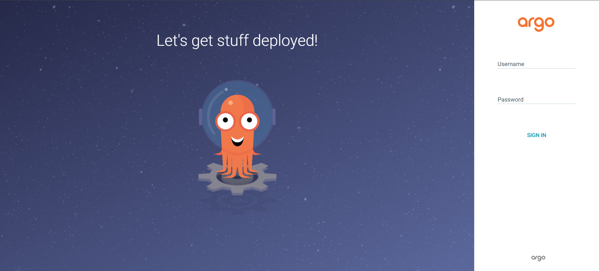
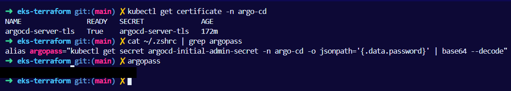
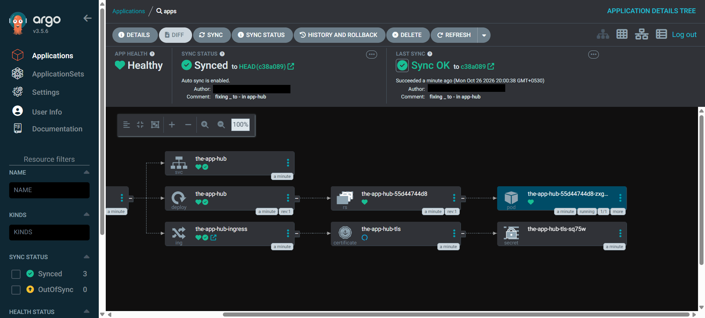
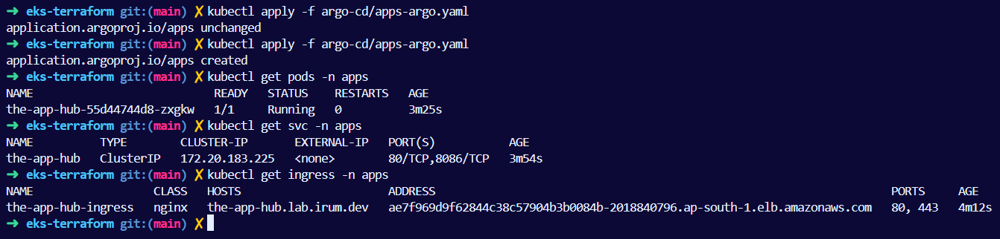
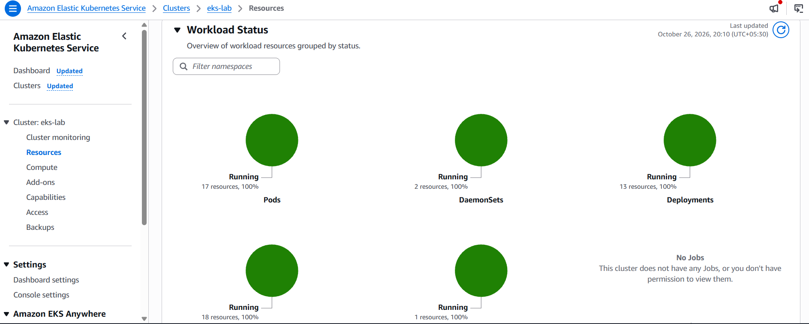

# EKS Platform with Terraform and GitOps (Argo CD)

Provisions an Amazon EKS cluster with Terraform, then deploys applications to it through GitOps with Argo CD. Every app is exposed over HTTPS on its own subdomain, with DNS records and TLS certificates created automatically.

Built as Project 1 (Part 1: Terraform + Kubernetes, Part 2: GitOps with Argo CD) of the CoderCo DevOps Academy.



## Contents

- [Architecture](#architecture)
- [What it does](#what-it-does)
- [Tech stack](#tech-stack)
- [Repository structure](#repository-structure)
- [Prerequisites](#prerequisites)
- [Deploy](#deploy)
- [Results](#results)
- [Tear down](#tear-down)
- [Errors I ran into and how I fixed them](#errors-i-ran-into-and-how-i-fixed-them)
- [Security notes](#security-notes)
- [What I'd improve next](#what-id-improve-next)

## Architecture

```text
                 https://argocd.lab.irum.dev
                 https://the-app-hub.lab.irum.dev
                            |
                            v
+----------------+    +----------------+
|   Cloudflare   |    |    Route 53    |<----------------------------+
|    irum.dev    |--->|  lab.irum.dev  |                             |
+----------------+ NS +-------+--------+                             |
                              |                                      |
                              v                                      |
                    +-------------------+                            |
                    | AWS Load Balancer |                            |
                    +---------+---------+                            |
                              |                                      |
+-----------------------------|--------------------------------------|------+
| EKS cluster: eks-lab (ap-south-1)                                  |      |
|                             v                                      |      |
|                    +-----------------+          +-------------+    |      |
|                    |  ingress-nginx  |          | ExternalDNS |----+      |
|                    +--------+--------+          +-------------+           |
|                             |                  creates A / TXT records    |
|               +-------------+-------------+                               |
|               |                           |                               |
|               v                           v                               |
|      +-----------------+         +-----------------+                      |
|      |     Argo CD     |-------->|   the-app-hub   |                      |
|      |  namespace:     | deploys |  namespace:     |                      |
|      |  argo-cd        |         |  apps           |                      |
|      +--------+--------+         +-----------------+                      |
|               ^                                                           |
|               |                  +--------------+                         |
|               |                  | cert-manager |---> Let's Encrypt       |
|               |                  +--------------+     (DNS-01 via         |
|               |                  issues TLS certs      Route 53)          |
+---------------|-----------------------------------------------------------+
                | watches kubernetes/eks-terraform/apps
        +-------+--------+
        |  GitHub repo   |
        +----------------+
```

**How a change reaches users:** push a manifest change to GitHub → Argo CD detects it and syncs it into the cluster → ExternalDNS creates the DNS record for the Ingress host → cert-manager issues a TLS certificate → ingress-nginx serves the app over HTTPS.

## What it does

**Part 1: platform (Terraform)**

- **VPC** across multiple Availability Zones with public and private subnets and a NAT gateway
- **EKS cluster** (`eks-lab`) with a managed node group and IRSA enabled
- **ingress-nginx** as the ingress controller, exposed through an AWS load balancer
- **ExternalDNS** watches Ingress resources and creates matching records in Route 53
- **cert-manager** issues Let's Encrypt certificates using the DNS-01 challenge on Route 53
- **IRSA** gives ExternalDNS and cert-manager their own IAM roles scoped to the hosted zone, so no static AWS keys exist in the cluster

**Part 2: GitOps (Argo CD)**

- **Argo CD**, installed with Terraform, served at `argocd.lab.irum.dev` with its own TLS certificate
- An Argo CD **Application** that watches `kubernetes/eks-terraform/apps` in this repo, with auto-sync enabled
- **the-app-hub**: a Deployment, Service and Ingress deployed purely from Git, served at `the-app-hub.lab.irum.dev`

## Tech stack

| Component                                    | Version             |
| -------------------------------------------- | ------------------- |
| `terraform-aws-modules/vpc/aws`              | 5.9.0               |
| `terraform-aws-modules/eks/aws`              | ~> 20.0             |
| `terraform-aws-modules/iam/aws` (IRSA roles) | 5.2.0               |
| AWS provider                                 | ~> 5.0              |
| Helm provider                                | ~> 3.0              |
| ingress-nginx chart                          | 4.15.1              |
| Argo CD chart (Argo CD v3.5.6)               | 10.11.3             |
| cert-manager chart                           | pinned in `helm.tf` |
| external-dns chart                           | pinned in `helm.tf` |

Every module, provider and chart is pinned. Most of the errors below came from versions that weren't.

## Repository structure

```text
eks-terraform/
├── providers.tf              # AWS, Helm and Kubernetes providers
├── locals.tf                 # names, domain and tags
├── vpc.tf                    # VPC, subnets, NAT gateway
├── eks.tf                    # EKS cluster and managed node group
├── irsa.tf                   # IAM roles for cert-manager and ExternalDNS
├── helm.tf                   # ingress-nginx, cert-manager, ExternalDNS, Argo CD
├── helm-values/
│   ├── argocd.yaml
│   ├── cert-manager.yaml
│   └── external-dns.yaml
├── cert-man/
│   └── issuers.yaml          # Let's Encrypt ClusterIssuer
├── argocd-apps/
│   └── apps-argo.yaml        # Argo CD Application pointing at apps/
├── apps/
│   └── app-hub.yaml          # Deployment, Service and Ingress for the-app-hub
└── images/                   # screenshots used in this README
```

> No folder may share a name with a Helm chart (`cert-manager`, `argo-cd`, `external-dns`, `ingress-nginx`). Helm treats a matching local folder as a chart and ignores the repository. See the errors section.

## Prerequisites

- An AWS account and the AWS CLI v2, configured (`aws sts get-caller-identity` works)
- Terraform, `kubectl` and `helm`
- A domain you control. Here, `lab.irum.dev` is a Route 53 hosted zone delegated from Cloudflare, which hosts `irum.dev`:
  1. Create the hosted zone in Route 53.
  2. Copy its four NS records into the parent domain's DNS as NS records for the subdomain.
  3. Verify: `dig @<one-of-the-zone's-awsdns-servers> lab.irum.dev SOA` should return `NOERROR`.

> If the hosted zone is ever recreated, AWS assigns new name servers and the NS records in the parent domain must be updated.

## Deploy

**1. Build the platform**

```bash
terraform init
terraform plan
terraform apply

aws eks update-kubeconfig --name eks-lab --region ap-south-1
kubectl get pods -A
```

**2. Create the Let's Encrypt issuer**

```bash
kubectl apply -f cert-man/issuers.yaml
```

The issuer uses the DNS-01 challenge on Route 53 (staging server first, to avoid Let's Encrypt rate limits):

```yaml
apiVersion: cert-manager.io/v1
kind: ClusterIssuer
metadata:
  name: issuer
spec:
  acme:
    server: https://acme-staging-v02.api.letsencrypt.org/directory
    email: <your-email>
    privateKeySecretRef:
      name: issuer-account-key
    solvers:
      - selector:
          dnsZones:
            - lab.irum.dev
        dns01:
          route53:
            region: ap-south-1
```

**3. Log in to Argo CD**

```bash
kubectl get certificate -n argo-cd     # READY should be True

kubectl -n argo-cd get secret argocd-initial-admin-secret \
  -o jsonpath="{.data.password}" | base64 decode
```

Open `https://argocd.lab.irum.dev` and sign in as `admin` with that password.

**4. Hand the apps folder to Argo CD**

```bash
kubectl apply -f argocd-apps/apps-argo.yaml
```

A minimal version of the Application:

```yaml
apiVersion: argoproj.io/v1alpha1
kind: Application
metadata:
  name: apps
  namespace: argo-cd
spec:
  project: default
  source:
    repoURL: https://github.com/Irum-F/devops.git
    targetRevision: HEAD
    path: kubernetes/eks-terraform/apps
  destination:
    server: https://kubernetes.default.svc
    namespace: apps
  syncPolicy:
    automated: {}
    syncOptions:
      - CreateNamespace=true
```

From here, any change pushed to `kubernetes/eks-terraform/apps` is deployed automatically.

**5. Verify**

```bash
kubectl get pods,svc,ingress -n apps
kubectl get certificate -A
kubectl logs -n external-dns deploy/external-dns | tail
dig the-app-hub.lab.irum.dev @1.1.1.1
```

## Results

**Argo CD served on its own subdomain with a valid certificate**





**the-app-hub synced from Git: Deployment, Service, Ingress, certificate and secret all healthy**



**Workloads running in the `apps` namespace, Ingress on `the-app-hub.lab.irum.dev`**



**Cluster view in the EKS console: all pods, DaemonSets and Deployments running**



## Tear down

Order matters, because Kubernetes creates AWS resources (load balancer, DNS records) that Terraform doesn't track:

1. **Delete the apps in Argo CD** so their Ingresses and DNS records are removed.
2. **Run the cleanup script** to uninstall the Helm installations, which removes the AWS load balancer that ingress-nginx created.
3. **Destroy the infrastructure:**

   ```bash
   terraform destroy
   ```

> **Cost warning:** the EKS control plane, worker nodes, NAT gateway and load balancer are all billed by the hour. Tear everything down after each session.

If `destroy` hangs on subnets or the VPC, a load balancer is usually still attached. Delete it under EC2 → Load Balancers and run `destroy` again.

## Errors I ran into and how I fixed them

The tutorial code was written for older versions of almost everything, so much of the work was finding what had changed and why.

**Terraform and modules**

- **`An argument named "cluster_name" is not expected here`** (and similar for `cluster_version`, `cluster_endpoint_public_access`, `eks_managed_node_group_defaults`): EKS module v21 renamed most inputs, and the module wasn't pinned, so `init` pulled the newest version. Fixed by pinning the EKS module to `~> 20.0`.
- **`Unreadable module subdirectory ... iam-role-for-service-accounts-eks`**: IAM module v6 removed that submodule. Fixed by pinning the IAM module to `5.2.0`.
- **`InvalidParameterException: unsupported Kubernetes version 1.23`**: EKS no longer creates clusters on 1.23. Fixed by choosing a version in standard support (`aws eks describe-cluster-versions`).
- **`Missing key/value separator` on `exec {`, and `Blocks of type "set" are not expected here`**: Helm provider v3 changed `kubernetes`, `exec` and `set` from blocks to attributes. Fixed by switching to `exec = { ... }` and `set = [{ ... }]` and pinning the provider to `~> 3.0`.
- **`Unsupported block type` and `An argument named "values" is not expected here` in the ExternalDNS resource**: a closing brace sat before the `set` and `values` blocks, leaving them outside the resource. Fixed the brace placement.
- **ExternalDNS used cert-manager's IAM role**: a copy-paste slip pointed its role annotation at `module.cert_manager_irsa_role`. Fixed to `module.external_dns_irsa_role`.

**Helm charts**

- **`chart "nginx-ingress-controller" version "4.15.1" not found in https://charts.bitnami.com/bitnami`**: the version belonged to the official ingress-nginx chart, but the repository and chart name were still Bitnami's. Fixed by switching `repository` and `chart` to the official ingress-nginx chart.
- **`https://charts.bitnami.com/bitnami is not a valid chart repository or cannot be reached`**: Bitnami restricted its free charts and images. Fixed by moving ExternalDNS to the official `kubernetes-sigs` chart and rewriting its values file in that chart's format.
- **cert-manager: `values don't meet the specifications of the schema`**: `serviceAccount.annotation` was a typo for `annotations`, and `ingressShim.defaultACMEChallengeType` and `defaultACMEDNS01ChallengeProvider` were removed from newer cert-manager. Fixed by moving the DNS-01/Route 53 configuration into the ClusterIssuer's `solvers` block and setting the IAM role through Terraform instead of the values file.
- **`Unable to load chart .../cert-manager: Chart.yaml file is missing`** (and later the same for `argo-cd`, during `terraform destroy`): a project folder had the same name as the Helm chart, so Helm loaded the folder as a local chart and ignored the repository. Fixed by renaming the folders.

**DNS, IAM and certificates**

- **`server can't find lab.irum.dev: SERVFAIL`**: the NS records in Cloudflare pointed to the name servers of an earlier, recreated hosted zone. Fixed by copying the current zone's four name servers into Cloudflare, confirmed with `dig @<awsdns-server> lab.irum.dev SOA`.
- **Argo CD Ingress host was `argocd.example.com`**: the values file used the old chart format (`server.ingress.hosts` and a `tls` list), which the current chart ignores and falls back to its default domain. Fixed with `global.domain: argocd.lab.irum.dev`, `server.ingress.tls: true` and `configs.params.server.insecure: true` (so ingress-nginx terminates TLS without a redirect loop). An `nginx.org/hsts` annotation was also removed, since it belongs to a different nginx controller.
- **Site can't be reached / `NXDOMAIN`, with ExternalDNS logging `403 AccessDenied ... route53:ChangeResourceRecordSets`**: the IRSA policies built the hosted zone ARN from the domain name (`hostedzone/lab.irum.dev`) instead of the zone ID, so the roles had permission on a zone that doesn't exist. Fixed by looking the zone up with `data "aws_route53_zone"` and passing its `.arn` to both IRSA roles, so a recreated zone can't break it again.

**Argo CD and Git**

- **`Unable to load data: revision HEAD must be resolved` and status `Unknown`**: the Application's `path` was `apps`, but in this monorepo the folder lives at `kubernetes/eks-terraform/apps`. Fixed the path and re-applied the Application.
- **`ComparisonError ... app-hub.yaml ... yaml: line 25: could not find expected ':'`**: the document separator between the Deployment and Service was `___` (underscores) instead of `---`. Fixed the separator, validated with `kubectl apply --dry-run=client -f`, pushed, and hard-refreshed the app.
- **`warning: adding embedded git repository: irum-custom-actions`**: `git add` was run from the repo root, which picked up a separate Git repo inside it. Fixed with `git rm --cached irum-custom-actions` and added it to `.gitignore`.

**Main lessons:** pin every module, provider and chart version; don't trust tutorial code to match current tools; and debug from the actual error (logs, `dig`, `kubectl describe`) rather than the symptom.

## Security notes

- No static AWS credentials in the cluster: cert-manager and ExternalDNS authenticate through IRSA, each scoped to the one hosted zone.
- IAM role ARNs and the hosted zone ARN come from Terraform, not hardcoded values files.
- The Argo CD admin password is read from the cluster secret, never committed. For anything beyond a lab, change it or set up SSO, then delete `argocd-initial-admin-secret`.
- Terraform state, `.env`, `.tfvars` files and kubeconfigs are excluded from Git (see `.gitignore`).

## What I'd improve next

- Remote Terraform state in S3 with state locking
- App-of-apps or ApplicationSets so Argo CD manages the platform add-ons too
- Migrate from ingress-nginx (now retired) to the Gateway API
- Prometheus and Grafana for monitoring
- Restrict the EKS API endpoint to known IPs

## Happy coding!